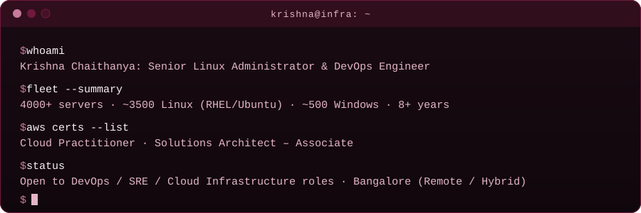
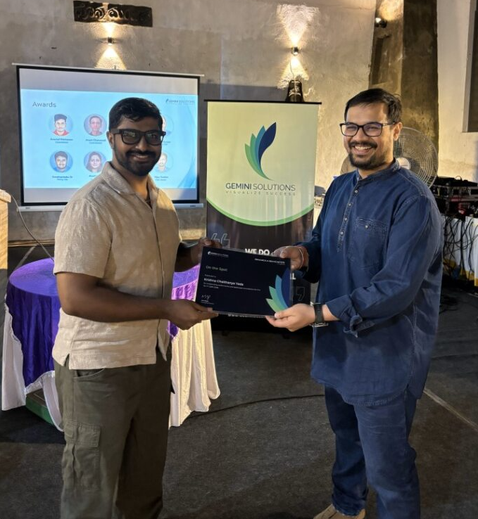

<!-- ============================================================ -->
<!--  KRISHNA CHAITHANYA · GITHUB PROFILE README (burgundy theme) -->
<!--  Palette: #10070C #190B12 #451126 #701A3D #C77B9B #E5B5C7    -->
<!--           #F8F0F3                                            -->
<!-- ============================================================ -->

<div align="center">



<br/><br/>


&nbsp;

&nbsp;

&nbsp;


<br/><br/>

<a href="https://yadakrishna245.github.io" title="Open my interactive portfolio">
  
</a>

<a href="https://yadakrishna245.github.io"></a>
&nbsp;
<a href="https://yadakrishna245.github.io/classic/"></a>

</div>

---

## 👋 About me

<div align="center">

</div>

I'm a Senior Linux Administrator and DevOps Engineer with 8+ years running enterprise production infrastructure. I currently look after 4000+ servers: about 3500 on Linux (RHEL and Ubuntu) and about 500 on Windows. Most of my work is patching at scale, incident ownership, automation with Ansible and Terraform, and keeping AWS and hybrid workloads healthy and monitored.

**Looking for:** DevOps Engineer, SRE or Cloud Infrastructure roles (Remote / Hybrid, Bangalore).

> *Automate everything repeatable · Secure by design · If it isn't monitored, it doesn't exist · Reliability is a feature*

---

## 🏆 Achievements & certifications

<table>
<tr>
<td width="45%" align="center" valign="top">

<br/>
<a href="https://www.linkedin.com/feed/update/urn:li:activity:7464191224032243712/"><b>🥇 On-the-Spot Award · Gemini Solutions Pvt Ltd</b></a>
<br/>
<sub>For production support, incident resolution and enterprise infrastructure reliability</sub>
</td>
<td width="55%" valign="top">

**AWS certifications**

- [AWS Certified Solutions Architect – Associate](https://www.linkedin.com/posts/krishna-yada-8a8441239_aws-awscertified-solutionsarchitect-activity-7449323540820152320-Eozp) · issued Apr 2026 · [certificate](<AWS Certified Solutions Architect - Associate certificate.pdf>)
- [AWS Certified Cloud Practitioner](https://www.linkedin.com/posts/krishna-yada-8a8441239_aws-cloudcomputing-awscertified-activity-7452297084487045120-On62) · issued Mar 2026 · [certificate](<AWS Certified Cloud Practitioner certificate.pdf>)
- AWS Certified CloudOps Engineer – Associate

**Other**

- [Claude Certified Associate – Foundations](https://www.credly.com/badges/380e0eaf-ff00-4a40-b7c3-e092667fd4a3) · issued Aug 2026 · [certificate](<Claude Certified Associate - Foundations certificate.pdf>)
- [Appreciation notes from teams and customers](<Appreciations for Krishna.pdf>)

</td>
</tr>
</table>

---

## 🚀 Selected projects

<table>
<tr>
<td width="50%" valign="top">

**[terraform-aws-infrastructure](https://github.com/yadakrishna245/terraform-aws-infrastructure)**<br/>
End-to-end AWS provisioning with Terraform: VPC, EC2, RDS, S3 and CloudFront.<br/>
<sub><code>Terraform</code> <code>HCL</code> <code>AWS</code></sub>

</td>
<td width="50%" valign="top">

**[Photo-Gallery serverless app](https://github.com/yadakrishna245/Photo-Gallery-App-Serverless-Capstone-Project)**<br/>
Secure image upload and viewing. Cognito for sign-in, Lambda and API Gateway for the backend, S3 and DynamoDB for storage, CloudFront for delivery.<br/>
<sub><code>AWS Lambda</code> <code>Cognito</code> <code>DynamoDB</code> <code>Python</code></sub>

</td>
</tr>
<tr>
<td width="50%" valign="top">

**[DockerShield](https://github.com/yadakrishna245/DockerShield)**<br/>
Docker image security scanner that looks for vulnerabilities, malware, secrets and misconfigurations before an image ships.<br/>
<sub><code>Python</code> <code>Docker</code></sub>

</td>
<td width="50%" valign="top">

**[github-security-scanner](https://github.com/yadakrishna245/github-security-scanner)**<br/>
Scans a GitHub profile for compromised npm/PyPI packages, leaked secrets and dependency vulnerabilities.<br/>
<sub><code>Python</code> <code>Security</code></sub>

</td>
</tr>
<tr>
<td width="50%" valign="top">

**[RDS-Blue-Green-Deployment](https://github.com/yadakrishna245/RDS-Blue-Green-Deployment)**<br/>
Blue/Green strategy on AWS RDS for zero-downtime database upgrades and migrations.<br/>
<sub><code>AWS RDS</code></sub>

</td>
<td width="50%" valign="top">

**[ECR DevSecOps pipeline](https://github.com/yadakrishna245/ECR-Devsecops-Commands-Image)**<br/>
Container build, image scanning and secure deployment with AWS ECR.<br/>
<sub><code>AWS ECR</code> <code>Docker</code> <code>DevSecOps</code></sub>

</td>
</tr>
</table>

---

## 🧰 Skills

<div align="center">

**Operating systems & cloud**<br/>


**DevOps & automation**<br/>


**Web, monitoring & tooling**<br/>


</div>

<table>
<tr>
<td width="50%" valign="top">

**🐧 Linux administration**
```text
Platform  : RHEL 7/8/9 · Ubuntu 20/22/24 LTS
Patching  : YUM / APT · kernel upgrades
Storage   : LVM · XFS · ext4 · NFS · iSCSI
Network   : bonding · VLAN · firewalld · iptables
Security  : SELinux · sudoers · SSH hardening
Perf      : top/htop · sar · vmstat · iostat
```

</td>
<td width="50%" valign="top">

**🪟 Windows administration**
```text
Platform  : Windows 10/11 · Server 2016/2019/2022
Directory : Active Directory · RBAC · GPO
Messaging : O365 · Exchange Online · Teams
Scripting : PowerShell · Batch
Support   : L2/L3 production troubleshooting
```

</td>
</tr>
<tr>
<td width="50%" valign="top">

**⚙️ DevOps & automation**
```text
SCM        : Git · GitHub
CI/CD      : Jenkins pipelines
Containers : Docker · Kubernetes
IaC        : Terraform · Ansible
Scripting  : Bash · Shell · Python
```

</td>
<td width="50%" valign="top">

**📊 Observability**
```text
APM     : Dynatrace · AppDynamics
Metrics : Prometheus · Grafana
DEX     : Nexthink
Alerts  : PagerDuty · ServiceNow
Logs    : journalctl · syslog
```

</td>
</tr>
</table>

---

## 🟪 Contribution heatmap

<div align="center">

<picture>
  <source media="(prefers-color-scheme: dark)" srcset="https://raw.githubusercontent.com/yadakrishna245/yadakrishna245/output/contribution-heatmap-dark.svg"/>
  
</picture>

<sub>Built from my real GitHub contribution data by a GitHub Action every 12 hours.</sub>

</div>

## 📈 GitHub activity

<div align="center">


</div>

---

## 🤝 Connect

<div align="center">

[](https://www.linkedin.com/in/krishna-yada-8a8441239)
&nbsp;
[](https://github.com/yadakrishna245)
&nbsp;
[](mailto:yadakrishna245@gmail.com)

<br/><br/>


</div>
